# Tez Yodla — dizayn arxivi

Eski Claude hisobidagi «Tez Yodla ilova dizayni» canvas'idan eksport (2026-11-22). 24 sahifa, 166 ekran.

## Tuzilma
- `umumiy/<sahifa>.jpg` — har sahifaning barcha ekranlari bitta rasmda (tez ko'rib chiqish uchun).
- `ekranlar/<sahifa>/NN-nomi.png` — har bir ekran alohida, to'liq o'lchamda (390 px kenglik).
- `sahifalar/<sahifa>.html` — asl eksport (brauzerda ochiladi; ichi siqilgan, matn sifatida o'qib bo'lmaydi).

## Qoidalar (dizayn)
- Yangi ekranlar faqat HOZIRGI ilova uslubida: ranglar va o'lchamlar `src/lib/theme.ts` dan, komponentlar `src/components/`.
- Asosiy tugma — laym, ikkinchi darajali — oq. Qora tugma YO'Q. Xato — qizil chegara/panel.
- Eng so'nggi va ilovaga eng yaqin namunalar: 20, 22, 23, 24-sahifalar.

## Sahifalar

### 01-v1-birinchi-versiya
_Tarixiy — birinchi versiya (uslub keyin o'zgargan)_

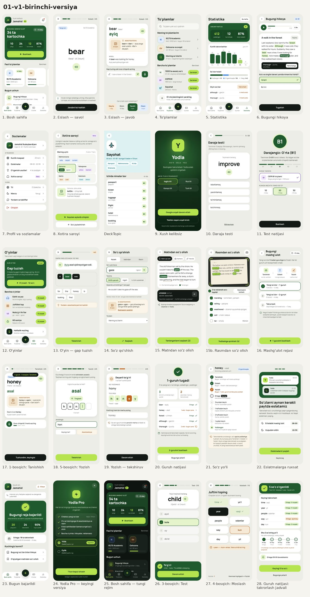

- `ekranlar/01-v1-birinchi-versiya/01-1-bosh-sahifa.png` — 1. Bosh sahifa
- `ekranlar/01-v1-birinchi-versiya/02-2-eslash-savol.png` — 2. Eslash — savol
- `ekranlar/01-v1-birinchi-versiya/03-3-eslash-javob.png` — 3. Eslash — javob
- `ekranlar/01-v1-birinchi-versiya/04-4-toplamlar.png` — 4. To'plamlar
- `ekranlar/01-v1-birinchi-versiya/05-5-statistika.png` — 5. Statistika
- `ekranlar/01-v1-birinchi-versiya/06-6-bugungi-hikoya.png` — 6. Bugungi hikoya
- `ekranlar/01-v1-birinchi-versiya/07-7-profil-va-sozlamalar.png` — 7. Profil va sozlamalar
- `ekranlar/01-v1-birinchi-versiya/08-8-xotira-saroyi.png` — 8. Xotira saroyi
- `ekranlar/01-v1-birinchi-versiya/09-decktopic.png` — DeckTopic
- `ekranlar/01-v1-birinchi-versiya/10-9-xush-kelibsiz.png` — 9. Xush kelibsiz
- `ekranlar/01-v1-birinchi-versiya/11-10-daraja-testi.png` — 10. Daraja testi
- `ekranlar/01-v1-birinchi-versiya/12-11-test-natijasi.png` — 11. Test natijasi
- `ekranlar/01-v1-birinchi-versiya/13-12-oyinlar.png` — 12. O'yinlar
- `ekranlar/01-v1-birinchi-versiya/14-13-oyin-gap-tuzish.png` — 13. O'yin — gap tuzish
- `ekranlar/01-v1-birinchi-versiya/15-14-soz-qoshish.png` — 14. So'z qo'shish
- `ekranlar/01-v1-birinchi-versiya/16-15-matndan-soz-olish.png` — 15. Matndan so'z olish
- `ekranlar/01-v1-birinchi-versiya/17-15b-rasmdan-soz-olish.png` — 15b. Rasmdan so'z olish
- `ekranlar/01-v1-birinchi-versiya/18-16-mashgulot-rejasi.png` — 16. Mashg'ulot rejasi
- `ekranlar/01-v1-birinchi-versiya/19-17-1-bosqich-tanishish.png` — 17. 1-bosqich: Tanishish
- `ekranlar/01-v1-birinchi-versiya/20-18-5-bosqich-yozish.png` — 18. 5-bosqich: Yozish
- `ekranlar/01-v1-birinchi-versiya/21-19-yozish-tekshiruv.png` — 19. Yozish — tekshiruv
- `ekranlar/01-v1-birinchi-versiya/22-20-guruh-natijasi.png` — 20. Guruh natijasi
- `ekranlar/01-v1-birinchi-versiya/23-21-soz-yoli.png` — 21. So'z yo'li
- `ekranlar/01-v1-birinchi-versiya/24-22-eslatmalarga-ruxsat.png` — 22. Eslatmalarga ruxsat
- `ekranlar/01-v1-birinchi-versiya/25-23-bugun-bajarildi.png` — 23. Bugun bajarildi
- `ekranlar/01-v1-birinchi-versiya/26-24-yodla-pro-keyingi-versiya.png` — 24. Yodla Pro — keyingi versiya
- `ekranlar/01-v1-birinchi-versiya/27-25-bosh-sahifa-tungi-rejim.png` — 25. Bosh sahifa — tungi rejim
- `ekranlar/01-v1-birinchi-versiya/28-26-3-bosqich-test.png` — 26. 3-bosqich: Test
- `ekranlar/01-v1-birinchi-versiya/29-27-4-bosqich-moslash.png` — 27. 4-bosqich: Moslash
- `ekranlar/01-v1-birinchi-versiya/30-28-guruh-natijasi-takrorlash-jadvali.png` — 28. Guruh natijasi: takrorlash jadvali

### 02-v2-yangi-yodlash-tajribasi
_Tarixiy — izlanish_

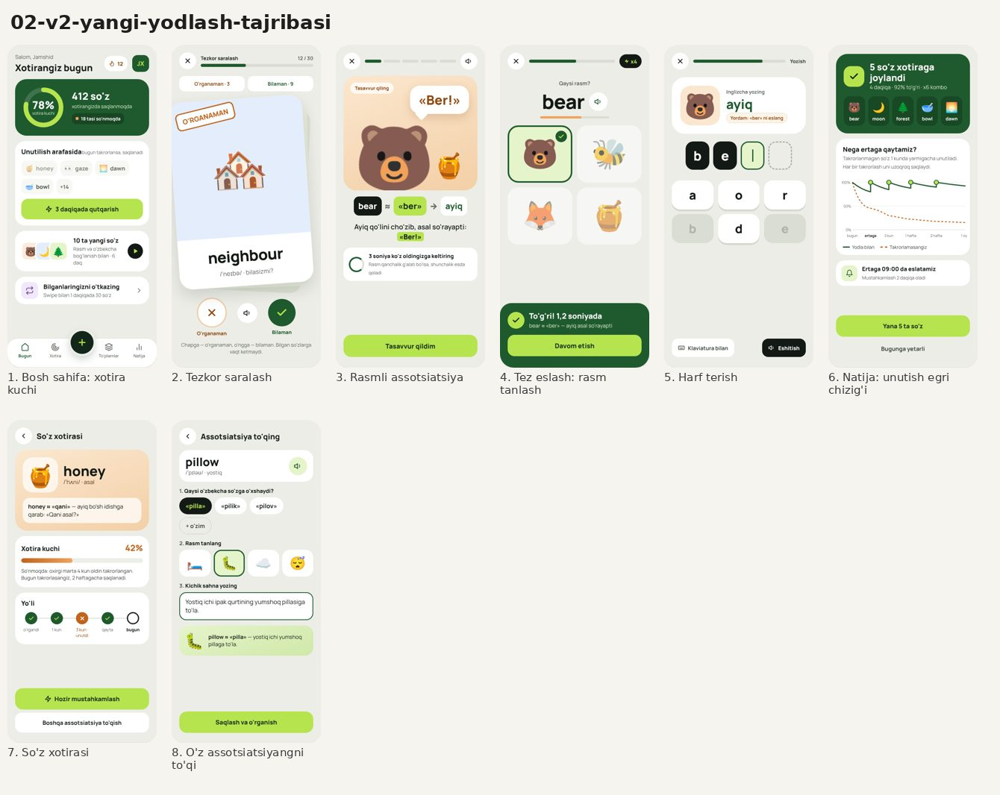

- `ekranlar/02-v2-yangi-yodlash-tajribasi/01-1-bosh-sahifa-xotira-kuchi.png` — 1. Bosh sahifa: xotira kuchi
- `ekranlar/02-v2-yangi-yodlash-tajribasi/02-2-tezkor-saralash.png` — 2. Tezkor saralash
- `ekranlar/02-v2-yangi-yodlash-tajribasi/03-3-rasmli-assotsiatsiya.png` — 3. Rasmli assotsiatsiya
- `ekranlar/02-v2-yangi-yodlash-tajribasi/04-4-tez-eslash-rasm-tanlash.png` — 4. Tez eslash: rasm tanlash
- `ekranlar/02-v2-yangi-yodlash-tajribasi/05-5-harf-terish.png` — 5. Harf terish
- `ekranlar/02-v2-yangi-yodlash-tajribasi/06-6-natija-unutish-egri-chizigi.png` — 6. Natija: unutish egri chizig'i
- `ekranlar/02-v2-yangi-yodlash-tajribasi/07-7-soz-xotirasi.png` — 7. So'z xotirasi
- `ekranlar/02-v2-yangi-yodlash-tajribasi/08-8-oz-assotsiatsiyangni-toqi.png` — 8. O'z assotsiatsiyangni to'qi

### 03-streak-kunlik-odat
_Streak (kunlik odat) — asosiy g'oyalar ilovada bor_

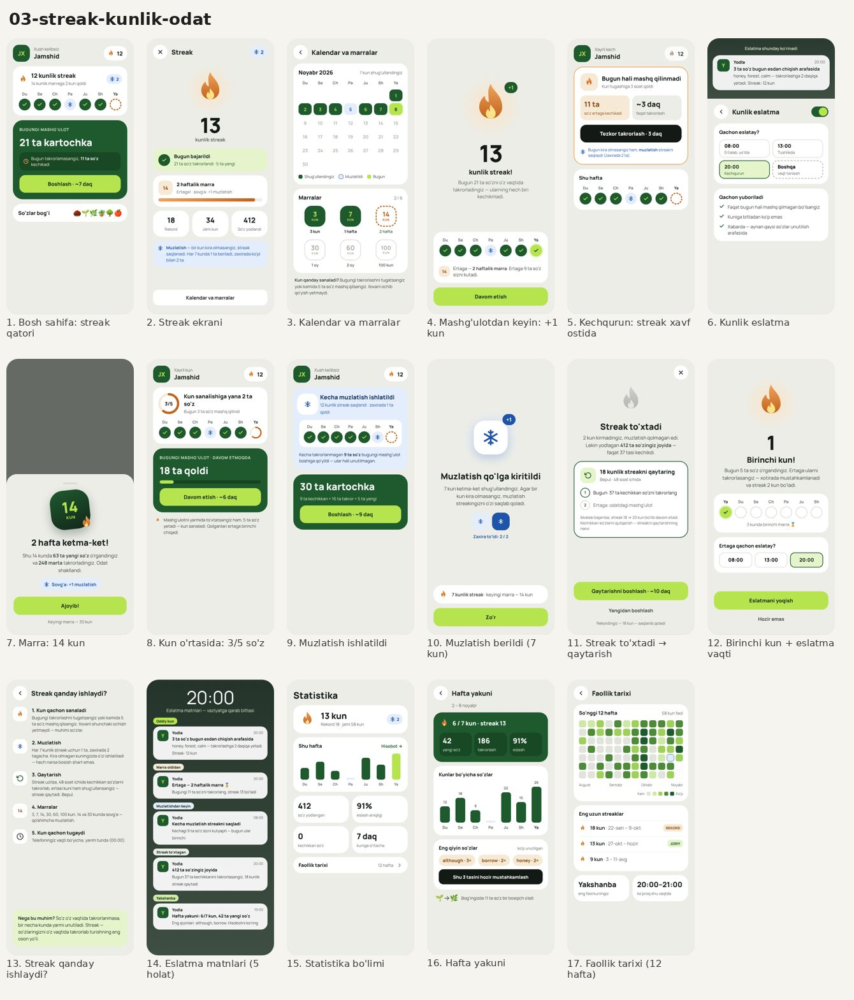

- `ekranlar/03-streak-kunlik-odat/01-1-bosh-sahifa-streak-qatori.png` — 1. Bosh sahifa: streak qatori
- `ekranlar/03-streak-kunlik-odat/02-2-streak-ekrani.png` — 2. Streak ekrani
- `ekranlar/03-streak-kunlik-odat/03-3-kalendar-va-marralar.png` — 3. Kalendar va marralar
- `ekranlar/03-streak-kunlik-odat/04-4-mashgulotdan-keyin-1-kun.png` — 4. Mashg'ulotdan keyin: +1 kun
- `ekranlar/03-streak-kunlik-odat/05-5-kechqurun-streak-xavf-ostida.png` — 5. Kechqurun: streak xavf ostida
- `ekranlar/03-streak-kunlik-odat/06-6-kunlik-eslatma.png` — 6. Kunlik eslatma
- `ekranlar/03-streak-kunlik-odat/07-7-marra-14-kun.png` — 7. Marra: 14 kun
- `ekranlar/03-streak-kunlik-odat/08-8-kun-ortasida-3-5-soz.png` — 8. Kun o'rtasida: 3/5 so'z
- `ekranlar/03-streak-kunlik-odat/09-9-muzlatish-ishlatildi.png` — 9. Muzlatish ishlatildi
- `ekranlar/03-streak-kunlik-odat/10-10-muzlatish-berildi-7-kun.png` — 10. Muzlatish berildi (7 kun)
- `ekranlar/03-streak-kunlik-odat/11-11-streak-toxtadi-qaytarish.png` — 11. Streak to'xtadi → qaytarish
- `ekranlar/03-streak-kunlik-odat/12-12-birinchi-kun-eslatma-vaqti.png` — 12. Birinchi kun + eslatma vaqti
- `ekranlar/03-streak-kunlik-odat/13-13-streak-qanday-ishlaydi.png` — 13. Streak qanday ishlaydi?
- `ekranlar/03-streak-kunlik-odat/14-14-eslatma-matnlari-5-holat.png` — 14. Eslatma matnlari (5 holat)
- `ekranlar/03-streak-kunlik-odat/15-15-statistika-bolimi.png` — 15. Statistika bo'limi
- `ekranlar/03-streak-kunlik-odat/16-16-hafta-yakuni.png` — 16. Hafta yakuni
- `ekranlar/03-streak-kunlik-odat/17-17-faollik-tarixi-12-hafta.png` — 17. Faollik tarixi (12 hafta)

### 04-sozlamalar
_Sozlamalar_

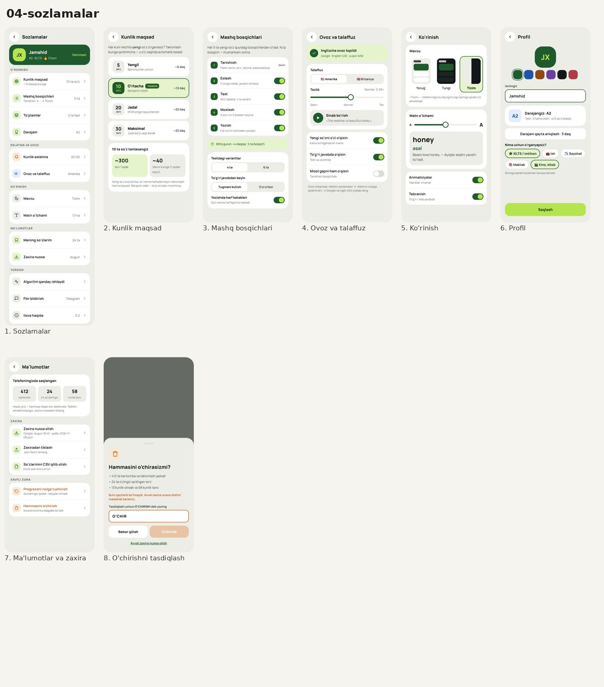

- `ekranlar/04-sozlamalar/01-1-sozlamalar.png` — 1. Sozlamalar
- `ekranlar/04-sozlamalar/02-2-kunlik-maqsad.png` — 2. Kunlik maqsad
- `ekranlar/04-sozlamalar/03-3-mashq-bosqichlari.png` — 3. Mashq bosqichlari
- `ekranlar/04-sozlamalar/04-4-ovoz-va-talaffuz.png` — 4. Ovoz va talaffuz
- `ekranlar/04-sozlamalar/05-5-korinish.png` — 5. Ko'rinish
- `ekranlar/04-sozlamalar/06-6-profil.png` — 6. Profil
- `ekranlar/04-sozlamalar/07-7-malumotlar-va-zaxira.png` — 7. Ma'lumotlar va zaxira
- `ekranlar/04-sozlamalar/08-8-ochirishni-tasdiqlash.png` — 8. O'chirishni tasdiqlash

### 05-v3-kuchaytirilgan-dizayn
_Tarixiy — v3 (brend, nom «Tez Yodla» shu yerda paydo bo'lgan)_

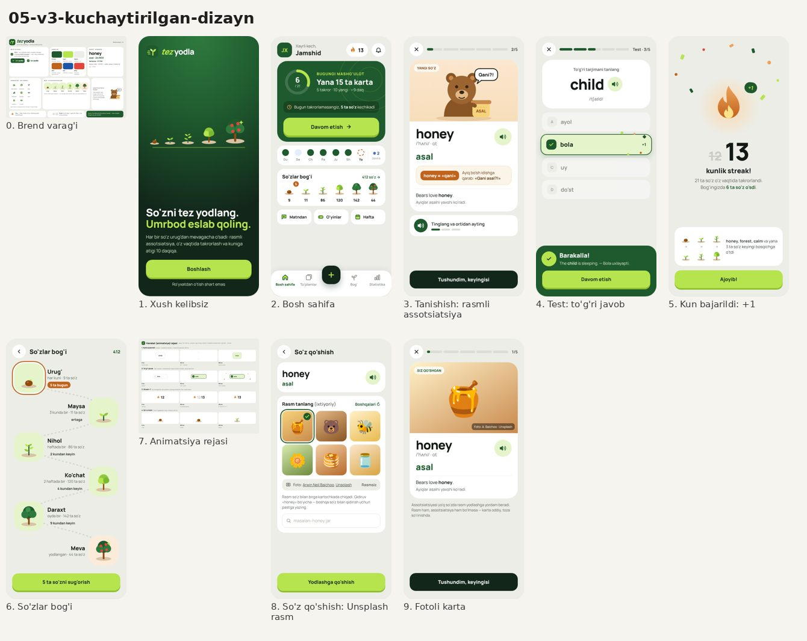

- `ekranlar/05-v3-kuchaytirilgan-dizayn/01-0-brend-varagi.png` — 0. Brend varag'i
- `ekranlar/05-v3-kuchaytirilgan-dizayn/02-1-xush-kelibsiz.png` — 1. Xush kelibsiz
- `ekranlar/05-v3-kuchaytirilgan-dizayn/03-2-bosh-sahifa.png` — 2. Bosh sahifa
- `ekranlar/05-v3-kuchaytirilgan-dizayn/04-3-tanishish-rasmli-assotsiatsiya.png` — 3. Tanishish: rasmli assotsiatsiya
- `ekranlar/05-v3-kuchaytirilgan-dizayn/05-4-test-togri-javob.png` — 4. Test: to'g'ri javob
- `ekranlar/05-v3-kuchaytirilgan-dizayn/06-5-kun-bajarildi-1.png` — 5. Kun bajarildi: +1
- `ekranlar/05-v3-kuchaytirilgan-dizayn/07-6-sozlar-bogi.png` — 6. So'zlar bog'i
- `ekranlar/05-v3-kuchaytirilgan-dizayn/08-7-animatsiya-rejasi.png` — 7. Animatsiya rejasi
- `ekranlar/05-v3-kuchaytirilgan-dizayn/09-8-soz-qoshish-unsplash-rasm.png` — 8. So'z qo'shish: Unsplash rasm
- `ekranlar/05-v3-kuchaytirilgan-dizayn/10-9-fotoli-karta.png` — 9. Fotoli karta

### 06-profil-v3
_Profil_

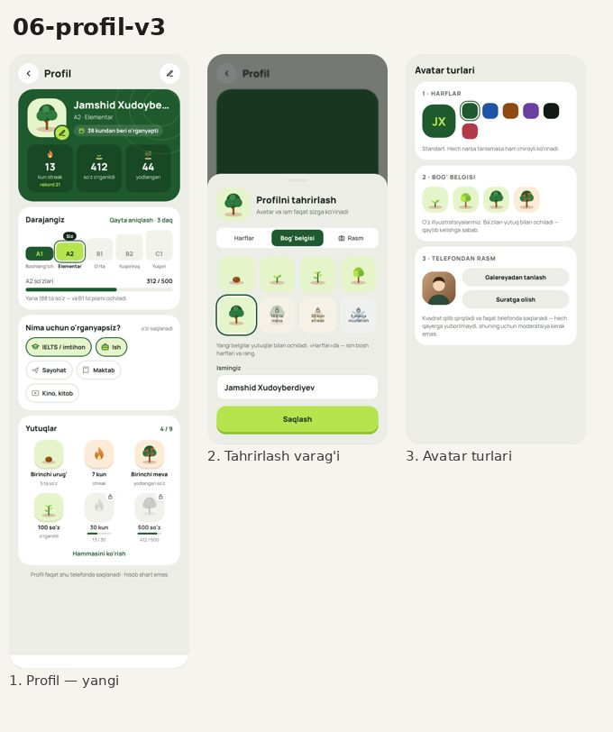

- `ekranlar/06-profil-v3/01-1-profil-yangi.png` — 1. Profil — yangi
- `ekranlar/06-profil-v3/02-2-tahrirlash-varagi.png` — 2. Tahrirlash varag'i
- `ekranlar/06-profil-v3/03-3-avatar-turlari.png` — 3. Avatar turlari

### 07-eslatma-vaqtlari
_Eslatma vaqtlari_

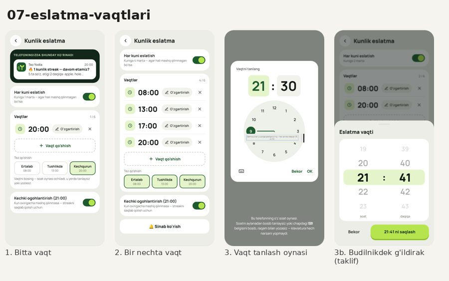

- `ekranlar/07-eslatma-vaqtlari/01-1-bitta-vaqt.png` — 1. Bitta vaqt
- `ekranlar/07-eslatma-vaqtlari/02-2-bir-nechta-vaqt.png` — 2. Bir nechta vaqt
- `ekranlar/07-eslatma-vaqtlari/03-3-vaqt-tanlash-oynasi.png` — 3. Vaqt tanlash oynasi
- `ekranlar/07-eslatma-vaqtlari/04-3b-budilnikdek-gildirak-taklif.png` — 3b. Budilnikdek g'ildirak (taklif)

### 08-moslash-juftini-toping
_Moslash — A/B/C variantlar_

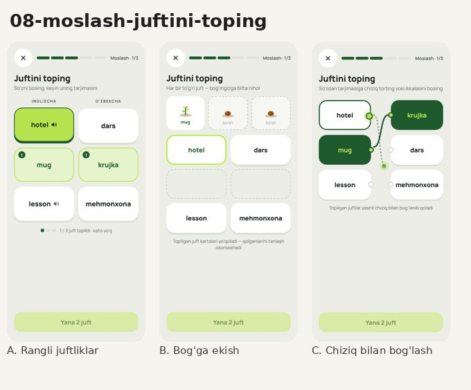

- `ekranlar/08-moslash-juftini-toping/01-a-rangli-juftliklar.png` — A. Rangli juftliklar
- `ekranlar/08-moslash-juftini-toping/02-b-bogga-ekish.png` — B. Bog'ga ekish
- `ekranlar/08-moslash-juftini-toping/03-c-chiziq-bilan-boglash.png` — C. Chiziq bilan bog'lash

### 09-yozish-va-tanishish
_Yozish (katakchalar), xato holati = QIZIL CHEGARA (tasdiqlangan qoida), qora tugma yo'q_

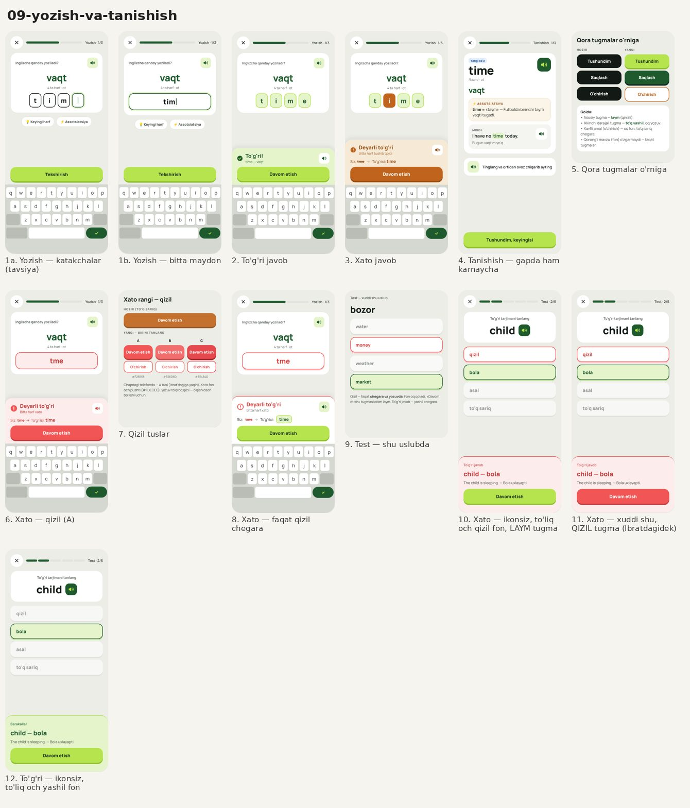

- `ekranlar/09-yozish-va-tanishish/01-1a-yozish-katakchalar-tavsiya.png` — 1a. Yozish — katakchalar (tavsiya)
- `ekranlar/09-yozish-va-tanishish/02-1b-yozish-bitta-maydon.png` — 1b. Yozish — bitta maydon
- `ekranlar/09-yozish-va-tanishish/03-2-togri-javob.png` — 2. To'g'ri javob
- `ekranlar/09-yozish-va-tanishish/04-3-xato-javob.png` — 3. Xato javob
- `ekranlar/09-yozish-va-tanishish/05-4-tanishish-gapda-ham-karnaycha.png` — 4. Tanishish — gapda ham karnaycha
- `ekranlar/09-yozish-va-tanishish/06-5-qora-tugmalar-orniga.png` — 5. Qora tugmalar o'rniga
- `ekranlar/09-yozish-va-tanishish/07-6-xato-qizil-a.png` — 6. Xato — qizil (A)
- `ekranlar/09-yozish-va-tanishish/08-7-qizil-tuslar.png` — 7. Qizil tuslar
- `ekranlar/09-yozish-va-tanishish/09-8-xato-faqat-qizil-chegara.png` — 8. Xato — faqat qizil chegara
- `ekranlar/09-yozish-va-tanishish/10-9-test-shu-uslubda.png` — 9. Test — shu uslubda
- `ekranlar/09-yozish-va-tanishish/11-10-xato-ikonsiz-toliq-och-qizil-fon-laym-tugma.png` — 10. Xato — ikonsiz, to'liq och qizil fon, LAYM tugma
- `ekranlar/09-yozish-va-tanishish/12-11-xato-xuddi-shu-qizil-tugma-ibratdagidek.png` — 11. Xato — xuddi shu, QIZIL tugma (Ibratdagidek)
- `ekranlar/09-yozish-va-tanishish/13-12-togri-ikonsiz-toliq-och-yashil-fon.png` — 12. To'g'ri — ikonsiz, to'liq och yashil fon

### 10-toplamlar-mavzular
_To'plamlar — mavzular_

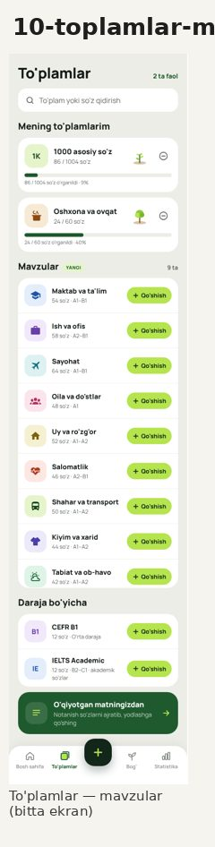

- `ekranlar/10-toplamlar-mavzular/01-toplamlar-mavzular-bitta-ekran.png` — To'plamlar — mavzular (bitta ekran)

### 11-qoshimcha-soz
_Reja bajarilgach «Yana 5 ta so'z»_

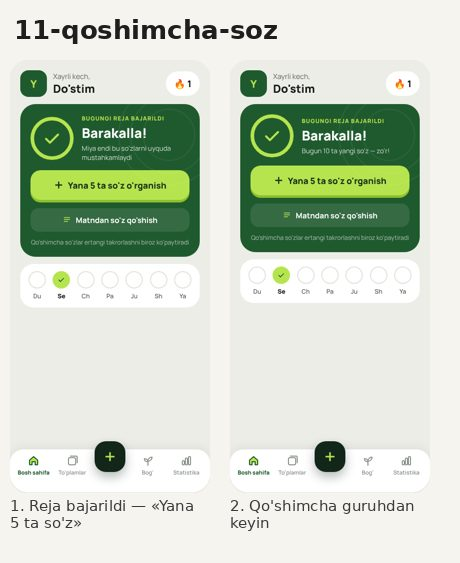

- `ekranlar/11-qoshimcha-soz/01-1-reja-bajarildi-yana-5-ta-soz.png` — 1. Reja bajarildi — «Yana 5 ta so'z»
- `ekranlar/11-qoshimcha-soz/02-2-qoshimcha-guruhdan-keyin.png` — 2. Qo'shimcha guruhdan keyin

### 12-xatolarim-va-matn
_Xatolarim va «Matnda» mashqi_

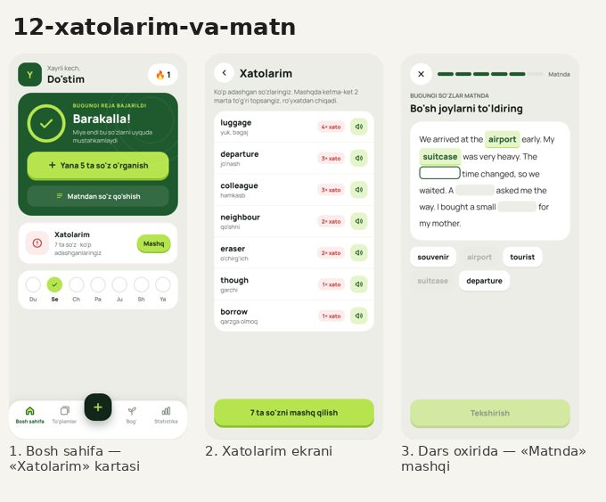

- `ekranlar/12-xatolarim-va-matn/01-1-bosh-sahifa-xatolarim-kartasi.png` — 1. Bosh sahifa — «Xatolarim» kartasi
- `ekranlar/12-xatolarim-va-matn/02-2-xatolarim-ekrani.png` — 2. Xatolarim ekrani
- `ekranlar/12-xatolarim-va-matn/03-3-dars-oxirida-matnda-mashqi.png` — 3. Dars oxirida — «Matnda» mashqi

### 13-toplamlar-v2
_To'plamlar v2 (ko'p mavzu)_

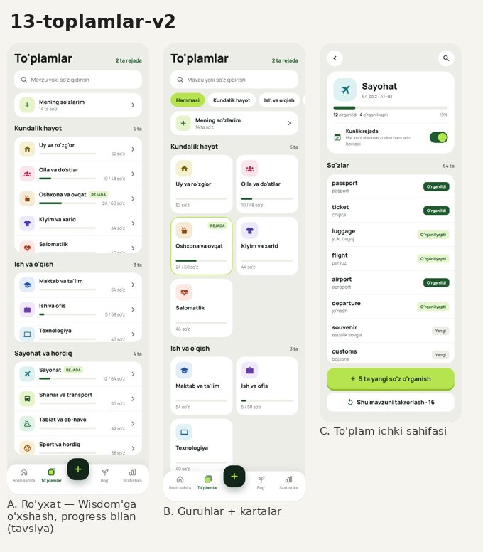

- `ekranlar/13-toplamlar-v2/01-a-royxat-wisdomga-oxshash-progress-bilan-tavsiya.png` — A. Ro'yxat — Wisdom'ga o'xshash, progress bilan (tavsiya)
- `ekranlar/13-toplamlar-v2/02-b-guruhlar-kartalar.png` — B. Guruhlar + kartalar
- `ekranlar/13-toplamlar-v2/03-c-toplam-ichki-sahifasi.png` — C. To'plam ichki sahifasi

### 14-tanishish-va-reja-v2
_Tanishish va reja v2_

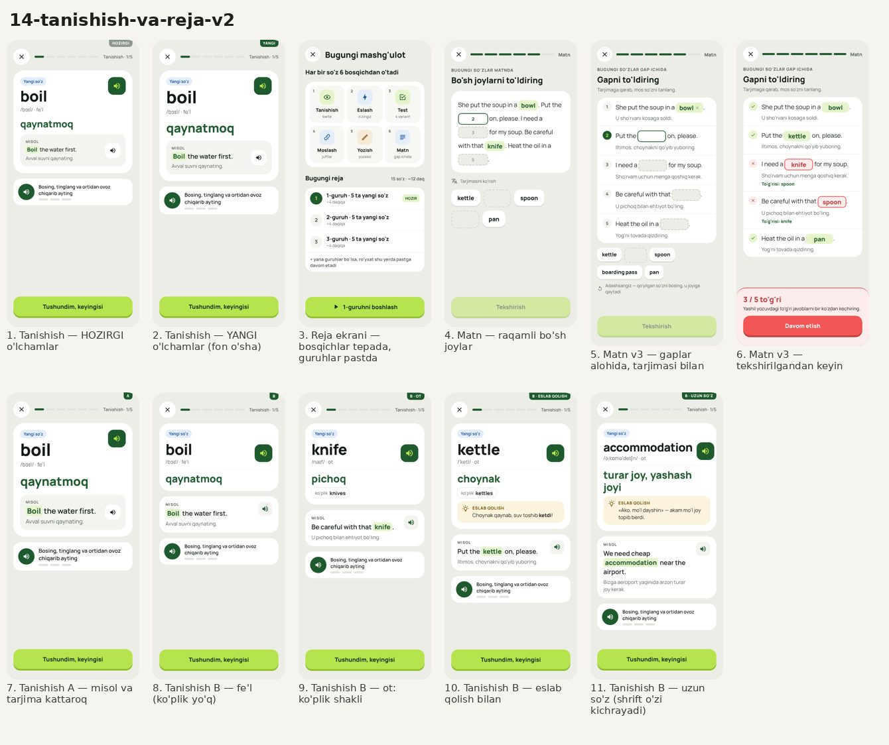

- `ekranlar/14-tanishish-va-reja-v2/01-1-tanishish-hozirgi-olchamlar.png` — 1. Tanishish — HOZIRGI o'lchamlar
- `ekranlar/14-tanishish-va-reja-v2/02-2-tanishish-yangi-olchamlar-fon-osha.png` — 2. Tanishish — YANGI o'lchamlar (fon o'sha)
- `ekranlar/14-tanishish-va-reja-v2/03-3-reja-ekrani-bosqichlar-tepada-guruhlar-pastda.png` — 3. Reja ekrani — bosqichlar tepada, guruhlar pastda
- `ekranlar/14-tanishish-va-reja-v2/04-4-matn-raqamli-bosh-joylar.png` — 4. Matn — raqamli bo'sh joylar
- `ekranlar/14-tanishish-va-reja-v2/05-5-matn-v3-gaplar-alohida-tarjimasi-bilan.png` — 5. Matn v3 — gaplar alohida, tarjimasi bilan
- `ekranlar/14-tanishish-va-reja-v2/06-6-matn-v3-tekshirilgandan-keyin.png` — 6. Matn v3 — tekshirilgandan keyin
- `ekranlar/14-tanishish-va-reja-v2/07-7-tanishish-a-misol-va-tarjima-kattaroq.png` — 7. Tanishish A — misol va tarjima kattaroq
- `ekranlar/14-tanishish-va-reja-v2/08-8-tanishish-b-fel-koplik-yoq.png` — 8. Tanishish B — fe'l (ko'plik yo'q)
- `ekranlar/14-tanishish-va-reja-v2/09-9-tanishish-b-ot-koplik-shakli.png` — 9. Tanishish B — ot: ko'plik shakli
- `ekranlar/14-tanishish-va-reja-v2/10-10-tanishish-b-eslab-qolish-bilan.png` — 10. Tanishish B — eslab qolish bilan
- `ekranlar/14-tanishish-va-reja-v2/11-11-tanishish-b-uzun-soz-shrift-ozi-kichrayadi.png` — 11. Tanishish B — uzun so'z (shrift o'zi kichrayadi)

### 15-matn-variantlar
_Matn bosqichi — variantlar_

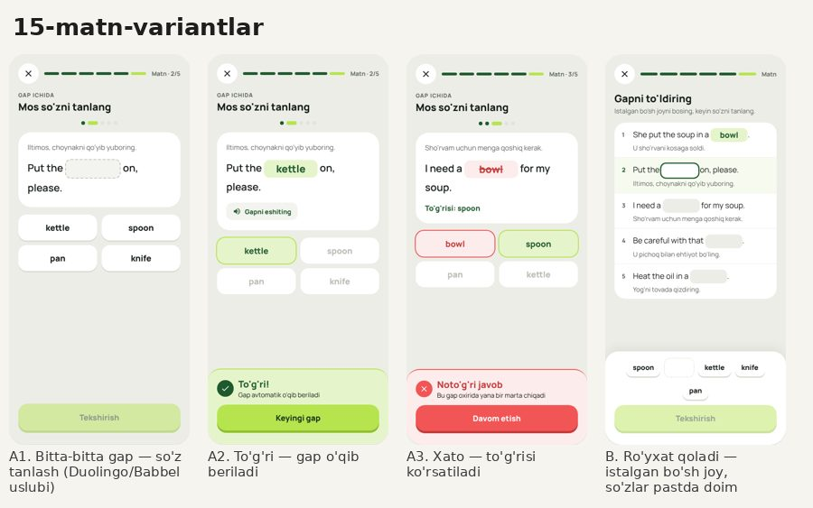

- `ekranlar/15-matn-variantlar/01-a1-bitta-bitta-gap-soz-tanlash-duolingo-babbel-usl.png` — A1. Bitta-bitta gap — so'z tanlash (Duolingo/Babbel uslubi)
- `ekranlar/15-matn-variantlar/02-a2-togri-gap-oqib-beriladi.png` — A2. To'g'ri — gap o'qib beriladi
- `ekranlar/15-matn-variantlar/03-a3-xato-togrisi-korsatiladi.png` — A3. Xato — to'g'risi ko'rsatiladi
- `ekranlar/15-matn-variantlar/04-b-royxat-qoladi-istalgan-bosh-joy-sozlar-pastda-do.png` — B. Ro'yxat qoladi — istalgan bo'sh joy, so'zlar pastda doim ko'rinadi

### 16-bosh-sahifa-reja-va-takrorlash
_Bosh sahifa — yangi so'zlar va takrorlash alohida_

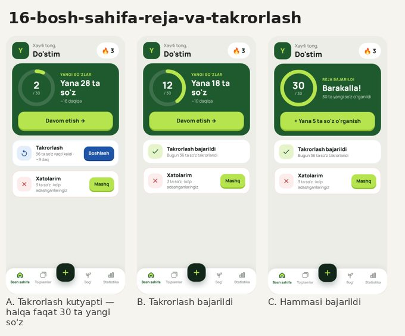

- `ekranlar/16-bosh-sahifa-reja-va-takrorlash/01-a-takrorlash-kutyapti-halqa-faqat-30-ta-yangi-soz.png` — A. Takrorlash kutyapti — halqa faqat 30 ta yangi so'z
- `ekranlar/16-bosh-sahifa-reja-va-takrorlash/02-b-takrorlash-bajarildi.png` — B. Takrorlash bajarildi
- `ekranlar/16-bosh-sahifa-reja-va-takrorlash/03-c-hammasi-bajarildi.png` — C. Hammasi bajarildi

### 17-tuzatishlar-soz-sahifasi-bosqichlar
_Tuzatishlar: so'z sahifasi, bosqichlar, ro'yxatdan o'tish_

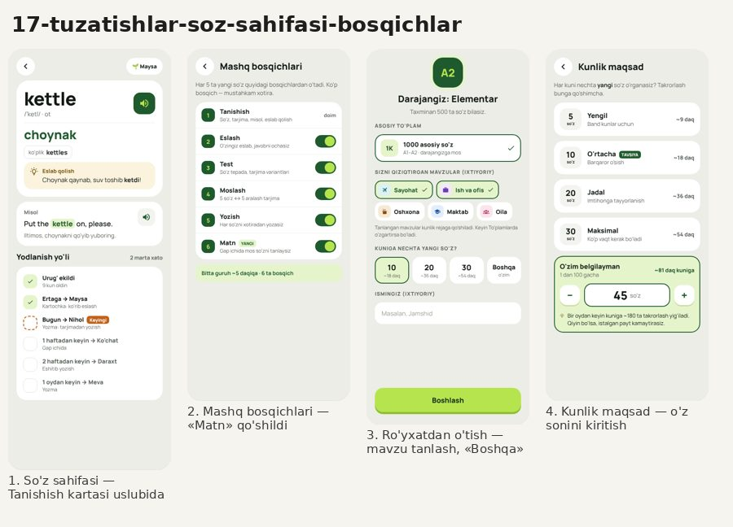

- `ekranlar/17-tuzatishlar-soz-sahifasi-bosqichlar/01-1-soz-sahifasi-tanishish-kartasi-uslubida.png` — 1. So'z sahifasi — Tanishish kartasi uslubida
- `ekranlar/17-tuzatishlar-soz-sahifasi-bosqichlar/02-2-mashq-bosqichlari-matn-qoshildi.png` — 2. Mashq bosqichlari — «Matn» qo'shildi
- `ekranlar/17-tuzatishlar-soz-sahifasi-bosqichlar/03-3-royxatdan-otish-mavzu-tanlash-boshqa.png` — 3. Ro'yxatdan o'tish — mavzu tanlash, «Boshqa»
- `ekranlar/17-tuzatishlar-soz-sahifasi-bosqichlar/04-4-kunlik-maqsad-oz-sonini-kiritish.png` — 4. Kunlik maqsad — o'z sonini kiritish

### 18-v4-bog-markazda
_v4 — muqobil yo'nalish (bog' markazda). To'liq qabul qilinmagan, yangi uslub sifatida ISHLATMANG_

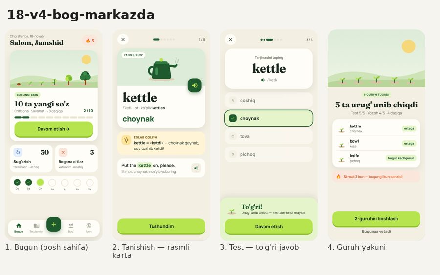

- `ekranlar/18-v4-bog-markazda/01-1-bugun-bosh-sahifa.png` — 1. Bugun (bosh sahifa)
- `ekranlar/18-v4-bog-markazda/02-2-tanishish-rasmli-karta.png` — 2. Tanishish — rasmli karta
- `ekranlar/18-v4-bog-markazda/03-3-test-togri-javob.png` — 3. Test — to'g'ri javob
- `ekranlar/18-v4-bog-markazda/04-4-guruh-yakuni.png` — 4. Guruh yakuni

### 19-takrorlash-chegarasi
_Kunlik takrorlash chegarasi — ilovada bor_

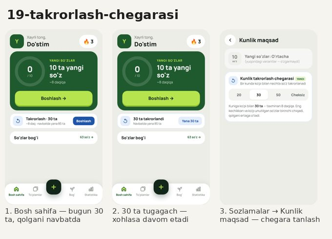

- `ekranlar/19-takrorlash-chegarasi/01-1-bosh-sahifa-bugun-30-ta-qolgani-navbatda.png` — 1. Bosh sahifa — bugun 30 ta, qolgani navbatda
- `ekranlar/19-takrorlash-chegarasi/02-2-30-ta-tugagach-xohlasa-davom-etadi.png` — 2. 30 ta tugagach — xohlasa davom etadi
- `ekranlar/19-takrorlash-chegarasi/03-3-sozlamalar-kunlik-maqsad-chegara-tanlash.png` — 3. Sozlamalar → Kunlik maqsad — chegara tanlash

### 20-mustahkamlash
_So'z yodlashni mustahkamlash (kechki tekshiruv, so'z yo'li, esda qolish %) — ilovada bor_

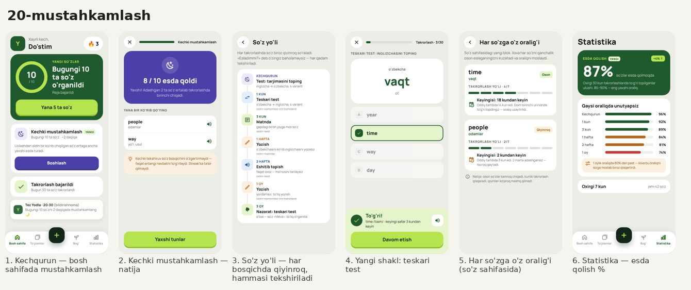

- `ekranlar/20-mustahkamlash/01-1-kechqurun-bosh-sahifada-mustahkamlash.png` — 1. Kechqurun — bosh sahifada mustahkamlash
- `ekranlar/20-mustahkamlash/02-2-kechki-mustahkamlash-natija.png` — 2. Kechki mustahkamlash — natija
- `ekranlar/20-mustahkamlash/03-3-soz-yoli-har-bosqichda-qiyinroq-hammasi-tekshiri.png` — 3. So'z yo'li — har bosqichda qiyinroq, hammasi tekshiriladi
- `ekranlar/20-mustahkamlash/04-4-yangi-shakl-teskari-test.png` — 4. Yangi shakl: teskari test
- `ekranlar/20-mustahkamlash/05-5-har-sozga-oz-oraligi-soz-sahifasida.png` — 5. Har so'zga o'z oralig'i (so'z sahifasida)
- `ekranlar/20-mustahkamlash/06-6-statistika-esda-qolish.png` — 6. Statistika — esda qolish %

### 21-tabiiy-ovoz-va-hisob
_Tabiiy ovoz va hisob — eski reja (Apple/Email kirish keyin olib tashlangan; kirish uchun 22-ga qarang)_

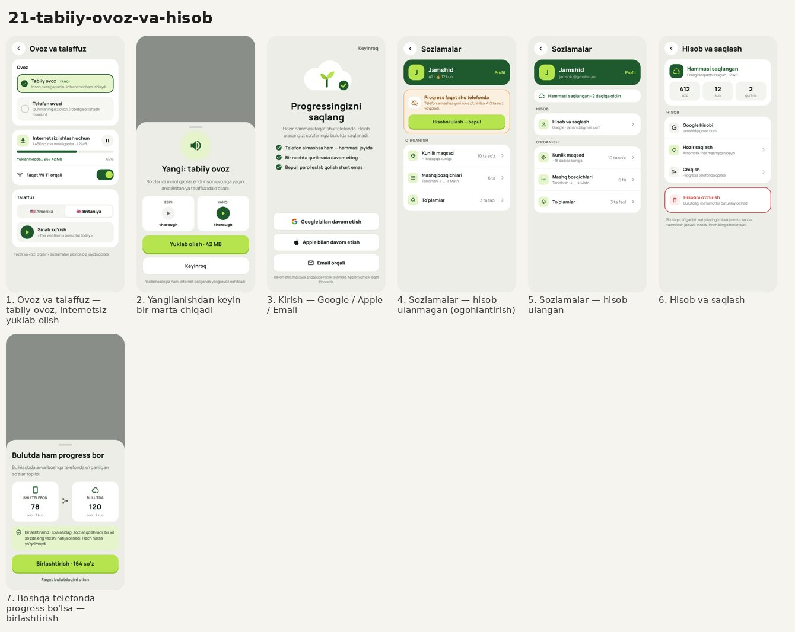

- `ekranlar/21-tabiiy-ovoz-va-hisob/01-1-ovoz-va-talaffuz-tabiiy-ovoz-internetsiz-yuklab-.png` — 1. Ovoz va talaffuz — tabiiy ovoz, internetsiz yuklab olish
- `ekranlar/21-tabiiy-ovoz-va-hisob/02-2-yangilanishdan-keyin-bir-marta-chiqadi.png` — 2. Yangilanishdan keyin bir marta chiqadi
- `ekranlar/21-tabiiy-ovoz-va-hisob/03-3-kirish-google-apple-email.png` — 3. Kirish — Google / Apple / Email
- `ekranlar/21-tabiiy-ovoz-va-hisob/04-4-sozlamalar-hisob-ulanmagan-ogohlantirish.png` — 4. Sozlamalar — hisob ulanmagan (ogohlantirish)
- `ekranlar/21-tabiiy-ovoz-va-hisob/05-5-sozlamalar-hisob-ulangan.png` — 5. Sozlamalar — hisob ulangan
- `ekranlar/21-tabiiy-ovoz-va-hisob/06-6-hisob-va-saqlash.png` — 6. Hisob va saqlash
- `ekranlar/21-tabiiy-ovoz-va-hisob/07-7-boshqa-telefonda-progress-bolsa-birlashtirish.png` — 7. Boshqa telefonda progress bo'lsa — birlashtirish

### 22-kirish-google
_Kirish — faqat Google (ilovada bor)_

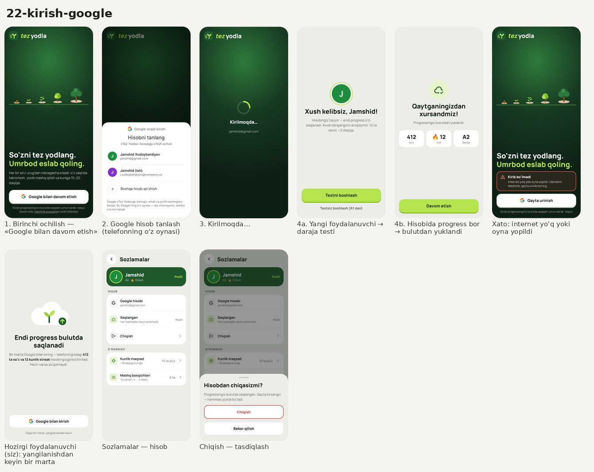

- `ekranlar/22-kirish-google/01-1-birinchi-ochilish-google-bilan-davom-etish.png` — 1. Birinchi ochilish — «Google bilan davom etish»
- `ekranlar/22-kirish-google/02-2-google-hisob-tanlash-telefonning-oz-oynasi.png` — 2. Google hisob tanlash (telefonning o'z oynasi)
- `ekranlar/22-kirish-google/03-3-kirilmoqda.png` — 3. Kirilmoqda…
- `ekranlar/22-kirish-google/04-4a-yangi-foydalanuvchi-daraja-testi.png` — 4a. Yangi foydalanuvchi → daraja testi
- `ekranlar/22-kirish-google/05-4b-hisobida-progress-bor-bulutdan-yuklandi.png` — 4b. Hisobida progress bor → bulutdan yuklandi
- `ekranlar/22-kirish-google/06-xato-internet-yoq-yoki-oyna-yopildi.png` — Xato: internet yo'q yoki oyna yopildi
- `ekranlar/22-kirish-google/07-hozirgi-foydalanuvchi-siz-yangilanishdan-keyin-bir.png` — Hozirgi foydalanuvchi (siz): yangilanishdan keyin bir marta
- `ekranlar/22-kirish-google/08-sozlamalar-hisob.png` — Sozlamalar — hisob
- `ekranlar/22-kirish-google/09-chiqish-tasdiqlash.png` — Chiqish — tasdiqlash

### 23-qulayliklar-davom-ettirish-eshitib-moslash
_Mashg'ulotni davom ettirish + eshitib moslash — ilovada bor_

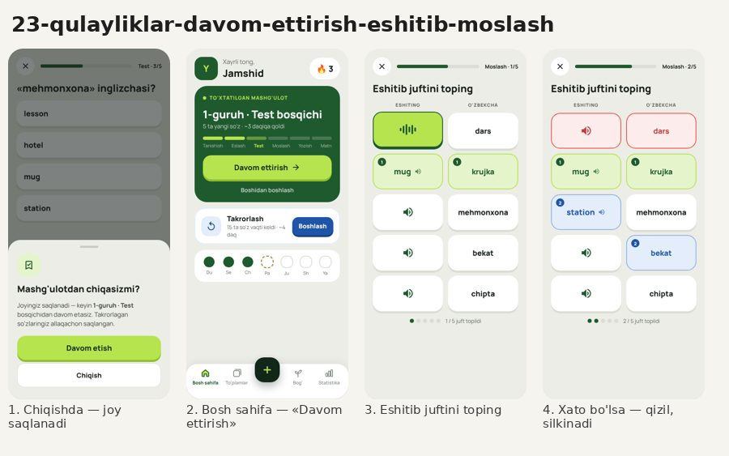

- `ekranlar/23-qulayliklar-davom-ettirish-eshitib-moslash/01-1-chiqishda-joy-saqlanadi.png` — 1. Chiqishda — joy saqlanadi
- `ekranlar/23-qulayliklar-davom-ettirish-eshitib-moslash/02-2-bosh-sahifa-davom-ettirish.png` — 2. Bosh sahifa — «Davom ettirish»
- `ekranlar/23-qulayliklar-davom-ettirish-eshitib-moslash/03-3-eshitib-juftini-toping.png` — 3. Eshitib juftini toping
- `ekranlar/23-qulayliklar-davom-ettirish-eshitib-moslash/04-4-xato-bolsa-qizil-silkinadi.png` — 4. Xato bo'lsa — qizil, silkinadi

### 24-quloqchin-rejimi
_Quloqchin rejimi — REJA, hali kodlanmagan_

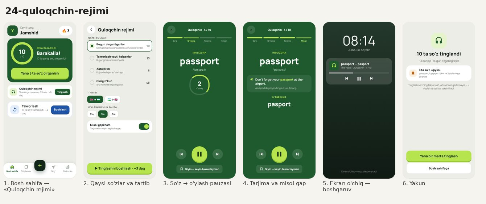

- `ekranlar/24-quloqchin-rejimi/01-1-bosh-sahifa-quloqchin-rejimi.png` — 1. Bosh sahifa — «Quloqchin rejimi»
- `ekranlar/24-quloqchin-rejimi/02-2-qaysi-sozlar-va-tartib.png` — 2. Qaysi so'zlar va tartib
- `ekranlar/24-quloqchin-rejimi/03-3-soz-oylash-pauzasi.png` — 3. So'z → o'ylash pauzasi
- `ekranlar/24-quloqchin-rejimi/04-4-tarjima-va-misol-gap.png` — 4. Tarjima va misol gap
- `ekranlar/24-quloqchin-rejimi/05-5-ekran-ochiq-boshqaruv.png` — 5. Ekran o'chiq — boshqaruv
- `ekranlar/24-quloqchin-rejimi/06-6-yakun.png` — 6. Yakun
